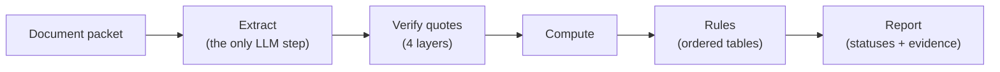

# bridge-evidence-check

A pre-attestation chart evidence checker for the Medicare GLP-1 Bridge.

## 1. What it checks

Before a prescriber signs the Bridge attestation, someone has to check the patient's documents for each eligibility condition: BMI at the start of GLP-1 therapy, the qualifying comorbidities, the exclusions, age and identity. This tool reads a document packet and reports, for every condition, one of five evidence statuses, each with verbatim evidence located in the source text. An LLM (Claude) only extracts fields and quotes. Deterministic code verifies every quote against the document, computes the derived values, applies the CMS rules and scores the result.

| Status | Meaning |
|---|---|
| `supported` | Evidence with a verbatim or normalized hit, and patient, assertion and timepoint all match |
| `not_supported` | Positive counter-evidence or evidence of absence |
| `insufficient` | Not mentioned, or only data that cannot support a conclusion |
| `conflict` | Contradictory values for the same fact that would change the result |
| `review` | Evidence exists, but a human must judge |

There is no sixth status and never a single overall verdict: the tool does not output "eligible" or "not eligible". Every condition is reported on its own, with the human-attention order `conflict` > `review` > `insufficient`.

## 2. How it works



**Extract.** One call to `claude-sonnet-5-5` with a single non-strict tool, `record_extraction`, whose input schema is the extraction schema. The raw response is committed to the database before parsing; the tool input is then validated locally. Structured outputs and strict tools were rejected by the API because the schema is too large, so local validation is the only check (`docs/adr/0002-extraction-output-mode.md`). If an extraction already exists for the cache key, the API is not called; verify, compute and rules still run again with the current code.

**Verify.** Every extracted quote passes four layers (`src/bridge_check/verify.py`, `docs/contracts.md` §6):

1. Position: verbatim, then conservative normalization. A fuzzy match is recorded only as a pointer for a human and never counts as verified.
2. Value in quote: the extracted value must sit inside the located quote.
3. Assertion: a sentence-level check against a frozen cue table (`rules/cues-v1.yaml`) for negation, history, family and the like.
4. Document-level exclusions: evidence from the PA draft never supports a clinical condition; evidence from a wrong-patient document is excluded from every condition.

The verifier matches fixed patterns from frozen tables; it does not understand text. What it refuses: a quote it cannot locate is excluded; an unrecognized cue sends the sub-result to `review`; a mismatching cue excludes the evidence; table-sourced values go to `review`.

**Compute.** Verified evidence becomes facts: the initiation date, document dates and timepoints, BMI candidates, age intervals, medication periods and normalized labs. Thresholds are compared on the unrounded BMI.

**Rules.** Decision tables are evaluated top to bottom and the first matching row is the result (`docs/contracts.md` §3). Thresholds and policies live in `rules/bridge-v1.yaml`, which carries the CMS source documents, their read date and one quoted sentence per rule. Without a verified GLP-1 start date no BMI result and no pathway is `supported`; exclusion sub-results are never `supported`; positive exclusion evidence returns `review`.

**Report.** `--json` carries the decisions, case flags and human workload. `--explain` lists every decision with the rule step that fired, the evidence used or excluded as `doc_id[start:end] sha8` with reasons, and the computed values, as machine codes only. Logs never contain document text.

Every run is bounded by one set of limits (`docs/adr/0001-global-limits.md`): at most 4 API attempts, 1 of them for parse, refusal or truncation, 5 minutes of wall clock, a request timeout, and two cost ceilings, $1.00 per run and $5.00 per evaluation, checked before each call. A call that would exceed a ceiling is refused and nothing downstream runs.

## 3. Results

Dev: one run of one model on 7 variants, used to find and fix errors. Holdout: frozen before the pipeline first ran on it, run once; pending. The numbers are counts over a deliberately chosen functional test set, not clinic performance, and zero errors on the dev set does not mean a near-zero real error rate.

| Measure | Dev (7 variants) | Holdout |
|---|---|---|
| Conditions correct (status and flags) | 133/140 | pending (frozen, not yet run) |
| Claims correct (status) | 36/39 | pending (frozen, not yet run) |
| False supports, conditions (target 0) | 0 of 112 gold non-supported rows | pending (frozen, not yet run) |
| Missed exclusion evidence | 0 of 2 | pending (frozen, not yet run) |
| Human workload (top-level `review` + `conflict` + `insufficient`) | 47 | pending (frozen, not yet run) |
| Packets with at least one human item | 7/7 | pending (frozen, not yet run) |
| Correctly automated among gold-automatable | 16/18 | pending (frozen, not yet run) |
| Cost of the live run (USD, 7 calls) | $0.47 | pending (frozen, not yet run) |

False supports are reported next to their denominators and per text-origin section, never summed. The current dev report with the first upstream error of every miss is `reports/eval-dev.md`; the scoring rules are in `docs/eval.md`.

## 4. Data

There is no real patient data from any EHR in this repository. Every GLP-1 scenario, date and identity is fictional, including those attached to real text.

| Source of the main document | In this release | Planned | Public form |
|---|---|---|---|
| MTSamples transcriptions | 2 (cases 01, 03) | 6 | fetched at run time, never committed |
| Published case reports (CC BY) | 1 public (case 17) + 3 hash-only rows (cases 11, 14, 16) | 6 | excerpt committed with attribution, or hash only |
| Authored synthetic documents | 4 variants (cases 02, 04, 07, 07b) | 6 (2 partly adapted from published cases, DOI cited as context, original text not used) | committed |

The remaining cases are planned, not present: this release holds the 7 dev variants in `cases/` and nothing else. Holdout variants and the private ladder level `case-15-L0` are listed in `splits.yaml` by sha256 only; `splits.yaml` has 4 hash-only rows (1 dev, `case-15-L0`; 3 holdout, cases 11, 14 and 16), which `bridge eval` skips. Their text stays outside the public repository. Referral letters, PA form drafts and other supporting documents are authored.

**CC BY passages.** Each passage is reproduced unmodified except that figures, videos and captions are omitted.

| Authors | Title | Journal | DOI | Licence | Excerpt | Modified |
|---|---|---|---|---|---|---|
| Abhinav Karan, Julien Feghaly, Anamarys Blanco, Calvin Choi | Dual Culprit ST-Elevation Myocardial Infarction: A Rare but Complex Clinical Entity | Cureus, 2025, 17(8), e90478 | [10.7759/cureus.90478](https://doi.org/10.7759/cureus.90478) | [CC BY 4.0](https://creativecommons.org/licenses/by/4.0/) | Case 1 heading and narrative prose (case-17) | no |

**Holdout main documents** (text not in this repository; listed by sha256 in `splits.yaml`). The private repository keeps the selected passages unmodified, with the selected table rows rendered as plain text; the holdout is run once after freezing.

| Case | Authors | Title | Journal | DOI | Licence | Excerpt |
|---|---|---|---|---|---|---|
| case-11 | Angela-Tu Nguyen and Jessica L. Binkley | Access Barriers and Variable Response to Semaglutide in Severe Adolescent Obesity: A Case Series | Case Reports in Pediatrics 2026;2026:5562574 | [10.1155/crpe/5562574](https://doi.org/10.1155/crpe/5562574) | [CC BY 4.0](https://creativecommons.org/licenses/by/4.0/) | Patient 3 paragraph |
| case-14 | Sara Mounsif, Omar Bahlaoui, Hanane Delsa, Wafaa Khannoussi, Imane Ben El Barhdadi | Metabolic Dysfunction-Associated Steatohepatitis With Positive Antimitochondrial M2 Antibodies: Diagnostic Pitfall and Importance of Follow-Up | Cureus 2025;17(12):e99347 | [10.7759/cureus.99347](https://doi.org/10.7759/cureus.99347) | [CC BY 4.0](https://creativecommons.org/licenses/by/4.0/) | Initial presentation and Table 1 |
| case-16 | Andrijana Koceva, Katarina Mlekuš Kozamernik, Andrej Janež, Rok Herman, Simona Ferjan, Mojca Jensterle | Case report: Long-term efficacy and safety of semaglutide in the treatment of syndromic obesity in Prader Willi syndrome - case series and literature review | Front Endocrinol (Lausanne) 2024;15:1528457 | [10.3389/fendo.2024.1528457](https://doi.org/10.3389/fendo.2024.1528457) | [CC BY 4.0](https://creativecommons.org/licenses/by/4.0/) | Patient 3 excerpt and Table 1 baseline rows |

**MTSamples.** The main document of the MTSamples cases is downloaded at run time by `scripts/fetch_mtsamples.py` from the mirror named in the case metadata, checked by whole-file and per-transcription sha256, and written byte-exact to a git-ignored path. MTSamples publishes its samples for educational use (print, share, link); they are not CC BY, they are not covered by this repository's licence, and commercial use would need separate handling. No MTSamples text is committed: gold, replays and public reports refer to it by `doc_id`, offset and sha256 only, and tests fail if any public file shares a 40-character window with a fetched document.

**Gold.** Gold is written by one human and frozen before the pipeline runs on a case. The extractor's output never becomes gold. Authored documents are drafted from a human-written spec by the data-side model and checked deterministically; candidate facts on real text are proposed by the same model and by a keyword scan, after a blind human draft. Every scored gold fact carries its `origin` (dev gold: 127 from spec, 31 from model candidates) and `review: human_verified`. The annotator has pharmacy and nutrition training and is not a physician. Thirteen clinical-judgement clauses in the annotation guide apply to gold items; the count decided by them is not yet reported, and none was reviewed by a physician.

## 5. Evaluation

Scoring is deterministic and reports counts only, never percentages (`docs/eval.md`).

- **Two levels.** The case level scores every condition and claim row against gold and charges each miss to its first upstream error (gold question, extraction missed, extraction wrong value, verifier excluded, compute timepoint, extraction extra, rules). The trap level is diagnostic: every `trap_id` a variant lists passes when the run completed and all its rows are correct.
- **Coverage matrix.** 19 traps × 5 test types (isolated real text, isolated minimal pair, rules fixture, integrated case, ladder level) = 95 cells; 24 of 95 are filled on dev. The empty cells are the "not covered" list in every report.
- **Regression check.** `bridge eval --baseline-from <git ref>` compares the run with the baseline at that ref. Regression kinds: a new false support, a status change, a flag change, an exclusion downgrade, a failed run or a missing case. Exit 0 no regression, 1 regression, 3 a run failed, 4 another run holds the lock.
- **Baseline policy.** A pull request that changes `reports/baseline-dev.json` needs `[update baseline]` in its title; CI enforces it. Dev and holdout are never in one report.
- **Out of scope until built.** The verifier ablation (with and without each layer on the same recorded extractions) and the rules-only table (gold facts fed straight to the rules) are named as out of scope in every report.

## 6. Failure recovery

A check can stop part way. Three scenarios are recovered from, each reproducible offline (`docs/recovery.md`):

1. Full raw response saved, parse interrupted: the rerun replays the parse, no API call.
2. No full response (timeout, or killed before the response was saved): the rerun calls the API again.
3. Extraction stored, rules failed or rolled back: cache hit, no API call; verify, compute and rules run again.

Recovery is at-least-once, not exactly-once: scenario 2 may call the API and pay again, and such an attempt is recorded as `unknown_outcome` and charged at the full reservation. Every earlier run stays visible in `bridge history`.

## 7. Limits, honestly

- One annotator, with pharmacy and nutrition training, not a physician. No second annotator and no physician review of any gold item.
- The context is synthetic. In this release 3 of the 7 dev variants have a third-party main document (2 MTSamples, 1 case report) and 4 are authored; the plan is 18 cases with 12 real main documents. Every referral, PA draft, GLP-1 start and timeline around real text is authored. This is not validation on real records.
- Not a clinical tool and not a CMS tool. It supports the attestation and does not replace the prescriber's judgement. It does not check plan type, dosage form or prescriber eligibility, and does not judge the purpose of use.
- The verifier cannot catch what its frozen lexicon does not name: unknown wording sends a fact to `review`, it does not parse tables, and a cue in one paragraph does not reach the next.
- Known gaps: heights written in feet and inches are `unparseable_value`; medication periods of the form "started on X, still on at Y" are not counted as certainly in use on Y; `program_type` has no value for a record that names only a limitation.
- Holdout cases are design-time known scenarios, not tuned on their runs. The author knows their content; the claim is only that nothing was adjusted on their results.
- No production deployment and no real patient data.

## 8. How I used AI

- **Planning** with one assistant: plans, contracts, the prompt for each pull request, and the assessment of every review.
- **Coding agent** on my machine writes the files under those prompts and stops before commit. I read the diff, run the checks and commit.
- **Review rounds**: every pull request gets a review from another AI colleague; I decide what to accept.
- **Data side**: `gpt-6.1-sol` drafts authored documents from my spec and proposes candidate facts on real text. It has no dated snapshot, so each response's `model` field and a UTC timestamp are recorded. The extractor under test is `claude-sonnet-5-5`. Neither model's output enters gold without my verification.
- **Decided by me, not by AI**: the policy and its sources, every scored gold item (AI proposes candidates and drafts; I verify each one), rule values, expected statuses, design decisions.
- **What the AI got wrong**, and what caught it: `docs/ai-errors.md`.

## 9. Run it

Install with `uv sync` (`--group dev --group data` for the data-line tools). Keys go in a git-ignored `.env`; see `.env.example`.

**Offline, no key.** The fake client returns a hand-written reply (`BRIDGE_FAKE_CLIENT=1`, or `no_tool_call`, `truncated`, `refusal`, `timeout`, `server_error`, `bad_request`). Replays of the recorded dev extractions live in `replays/` (MTSamples quotes as offset and hash only); the two MTSamples cases need the fetch first, otherwise they are skipped and the report is marked incomplete.

```
BRIDGE_FAKE_CLIENT=1 uv run bridge check fixtures/synthetic/case-smoke --json
uv run bridge history fixtures/synthetic/case-smoke
uv run python scripts/fetch_mtsamples.py
uv run bridge eval --split dev --offline --baseline-from origin/main
```

**Live.** Needs `ANTHROPIC_API_KEY`. Keep the database outside the checkout. The run stops before any call that would pass the ceilings.

```
BRIDGE_DB=/path/outside/checkout/live.db uv run --env-file .env bridge check cases/case-07 --json
uv run python scripts/compare_gold.py --db /path/outside/checkout/live.db --case case-07 --out compare.json
uv run python scripts/export_replay.py --db /path/outside/checkout/live.db --case case-07
uv run bridge eval --split dev --offline --write-baseline   # after committing the new replays
```

**Recovery demo.** Each boundary stops the run as a killed process would; the next check recovers.

```
BRIDGE_FAKE_CLIENT=1 BRIDGE_FAKE_FAULT=after_response_saved uv run bridge check fixtures/synthetic/case-smoke --db recovery.db   # exit 3
BRIDGE_FAKE_CLIENT=1 uv run bridge check fixtures/synthetic/case-smoke --db recovery.db   # replay, no API call
uv run bridge history fixtures/synthetic/case-smoke --db recovery.db
uv run pytest -q tests/test_recovery.py
```

Exit codes: 0 completed, 1 eval regression, 3 failed, 4 another run holds the lock. A `bridge.db` created by an older store version is refused; there are no migrations.

**Data-line tools** (`scripts/`): `fetch_mtsamples.py`, `draft_authored.py` (route 1, authored documents), `propose_candidates.py` (route 2, candidates on real text), `keyword_scan.py`, `validate_gold.py`. None of them writes gold or any annotator-owned file, holdout variants are never read, and private outputs are refused inside the public checkout. Prompts, drafting specs and raw model responses live in a private companion repository.

**CI** (every job runs on pull requests and all four are required to merge):

| Job | What it runs |
|---|---|
| `quality` | `ruff check`, `ruff format --check`, `mypy --strict`, `pytest -m "not live"`; `pip-audit` reported, never blocking |
| `tests` | MTSamples fetch (an unavailable mirror is reported, not fatal), then `pytest -m "not live"` |
| `data-integrity` | MTSamples fetch, `freeze_splits.py --check` against the PR base, `check_rules.py` |
| `eval` | `bridge eval --split dev --offline` against the base baseline, the baseline title guard, `pytest tests/eval`; the sanitized report is uploaded as the `eval-dev` artifact |

## 10. Licence

This repository is not yet licensed. Third-party material is used under its own licences and attributed in section 4. MTSamples text is fetched at run time under MTSamples' own terms and is not part of this repository.
